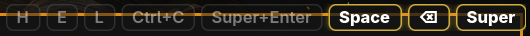

# keycast-overlay

A small, translucent, click-through overlay for Wayland that shows your most
recent key presses in a corner of the screen. The newest keys get a gold
outline and bright white text. Older keys fade to grey, so you can always
see what you just pressed.



It works well for screen recordings, tutorials, live streams, and pair
programming.

## Cross-Platform Editions

Looking for **Windows** or **macOS**? The `keycast-overlay` family is available natively across all three major desktop platforms:

| Platform | Repository | Highlights |
|---|---|---|
| **Windows 10 / 11** *(Featured)* | [techkayacodes/keycast-overlay-windows](https://github.com/techkayacodes/keycast-overlay-windows) | Standalone clickable [`.exe` download](https://github.com/techkayacodes/keycast-overlay-windows/releases/latest) (no Python/CLI needed), native Win32 hook, system tray |
| **macOS 13+** | [techkayacodes/keycast-overlay-macos](https://github.com/techkayacodes/keycast-overlay-macos) | Native Swift / AppKit `NSPanel`, `CGEventTap`, clickable `.app` bundler, menu bar controls |
| **Linux (Wayland)** *(this repo — Original)* | [techkayacodes/keycast-overlay](https://github.com/techkayacodes/keycast-overlay) | GTK 4 + `gtk4-layer-shell` + `showmethekey-cli` |

## Features

- Shows the last 8 keys. The 3 newest are highlighted in gold.
- Combos appear as one chip: `Ctrl+C`, `Super+Enter`, `Ctrl+Shift+T`.
- Tapping a modifier on its own (like `Super`) also shows up.
- Fully click-through. It never takes focus and never blocks your mouse.
- Sits above all windows using `wlr-layer-shell`. Tested on Hyprland
  (Omarchy). It should also work on Sway, river, and other wlroots-style
  compositors.
- Single instance. Launching it again while it's running does nothing.
- Nothing is logged or saved to disk. Keys exist only in memory while
  they're on screen.

## How it works

Wayland doesn't let regular apps see global key presses, so the overlay uses
`showmethekey-cli` from [Show Me The Key](https://github.com/AlynxZhou/showmethekey).
That helper reads keyboard events through libinput. The overlay starts it
with `pkexec`, then draws the keys itself with GTK 4 and
`gtk4-layer-shell`. Show Me The Key ships a polkit rule that lets users in
the `wheel` group run the helper without a password.

## Install

### Arch Linux / Omarchy

```sh
sudo pacman -S --needed showmethekey gtk4-layer-shell python-gobject python-cairo
git clone https://github.com/techkayacodes/keycast-overlay.git
cd keycast-overlay
./install.sh
```

`install.sh` copies the script to `~/.local/bin/keycast-overlay`.

### Other distributions

Install the equivalents of `showmethekey`, `gtk4-layer-shell`, PyGObject
(GTK 4) and pycairo, then copy `keycast-overlay` somewhere on your `PATH`.

## Usage

```sh
keycast-overlay              # start it
pkill -f keycast-overlay     # stop it
KEYCAST_DEMO=1 keycast-overlay   # preview with sample keys (no key capture)
```

### Start on login

**Omarchy:** add this to `~/.config/hypr/autostart.lua`:

```lua
o.launch_on_start("keycast-overlay")
```

**Hyprland (classic config):** `exec-once = keycast-overlay`

**Sway:** `exec keycast-overlay`

## Configuration

Edit the settings block at the top of `keycast-overlay`:

| Setting        | Default | Meaning                                          |
|----------------|---------|--------------------------------------------------|
| `MAX_KEYS`     | `8`     | How many keys stay on screen                     |
| `HIGHLIGHT`    | `3`     | How many of the newest keys get the gold outline |
| `FONT_SIZE`    | `11`    | Text size in px                                  |
| `MARGIN_TOP`   | `4`     | Gap below the top bar                            |
| `MARGIN_RIGHT` | `8`     | Gap from the right screen edge                   |
| `CLEAR_AFTER`  | `0`     | Seconds idle before clearing (`0` = never)       |

Colors live in the `CSS` block. The gold is `#d4af37`.

## Privacy

This tool reads every key you press, the same as any key visualizer. It only
displays keys. It never writes them to disk or sends them anywhere. Don't
leave it running while you type passwords on a recorded or shared screen.

## License

MIT. See [LICENSE](LICENSE).
